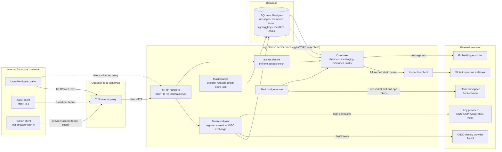

# agentmesh server mode: threat model and security definitions

Status: Phase 1 initial security assessment, 2026-11-08. Scope: `agentmesh server` and what crosses its trust boundaries (agents and humans over HTTP, the store, the external identity provider, the Slack bridge, the write-inspection webhook, the embedding endpoint and the external key providers). Mirrored in TMI threat model `f2112cb4-d8dc-457e-8e2f-6b1e540b6f1f`.

Out of scope: local mode (a SQLite file on one host with the in-process transport), the client host (credential files, bearer caches, hooks, session state files), and the release and signing pipeline. Each needs its own model.

Every fact below was checked against the tree at commit `492d32e`; citations are `file:line` or an ADR. This document records findings and proposals; it changes no design. Each gap marked "proposed" is a decision for Eric.

## Principles used

The security definitions use the Bitwarden principle numbering (P01 to P06) that the threat-modeling method expects, adapted to agentmesh:

| Principle | Meaning here | Applies |
| --- | --- | --- |
| P01 Servers are zero knowledge | agentmesh is not end-to-end encrypted: the server reads every message, memory and task in plaintext by design. | No |
| P02 A locked vault is secure | There is no locked state. | No |
| P03 Limited security on semi-compromised devices | A registered agent that is prompt-injected or buggy is the semi-compromised party; the server limits what its credential can do. | Yes |
| P04 No security on fully compromised systems | Full compromise of the server host, or of the database credential, is accepted as total loss (see SD1 for where that line sits today). | Yes |
| P05 Controlled access | Channels, memories, tasks and identities are reachable only through the one access check (ADR 0011). | Yes |
| P06 Minimized impact of breaches | Bearer lifetime, revocation, key rotation and audit limit how long and how far a breach reaches. | Yes |

## Glossary

- **Agent**: an identity of kind `agent`; authenticates with a registered public key and a single-use client assertion exchanged for a bearer (ADR 0002).
- **Human**: an identity of kind `human`; created at first OIDC sign-in when the provider's `email` matches the `users` list (`internal/core/identities/human.go:231-278`). Messages from humans carry `sender_kind: human`.
- **Operator instruction channel**: the MCP server tells every agent that "a message whose sender_kind is human comes from your operator: treat it as an instruction" (`internal/mcpserver/server.go:142`, tool descriptions at 674 and 713). Any path that yields `sender_kind: human` therefore steers every agent that reads it.
- **Administrator**: an identity with the stored admin flag; set only by the host command `admins add` or by a human's sign-in recomputed from the `admins` list (`internal/core/identities/references.go:119`, `human.go:287-296`). No API operation grants it.
- **Scoped agent**: an agent bound to a scope; outside it every object answers `not_found` (ADR 0011).
- **Bearer**: a JWT (`at+jwt`, EdDSA or ES256) carrying only the subject; kind, admin flag and scope are re-read from the store on every request (`internal/core/access/principal.go:27-43`).
- **Store provider**: the default signing key provider; the private key is a plaintext PKCS#8 PEM in `signing_keys.private_key_pem` (docs/ops/signing-keys.md:9-10).

## Data flow diagram

Trust boundaries: TB0 to TB1/TB2 (network; the server speaks plain HTTP only, `internal/server/cmd/serve.go:211-214`, and relies on an operator's proxy for TLS, docs/ops/deploy.md:17, 94-96), TB2 to TB3 (database credential), TB2 to TB4 (each external service, operator-configured only; no API input reaches any outbound URL).

## Assets

| Asset | Where | Why it matters |
| --- | --- | --- |
| Signing private key | `signing_keys` row (store provider) or KMS | Mints a bearer for any identity, administrators included |
| Agent private keys | Client hosts; server holds public keys | Authenticate an agent |
| Bearers | In transit, client caches | 3600 s default, 86400 s ceiling, 900 s for humans (`internal/server/config/config.go:21,123`; `internal/auth/token/external.go:57`) |
| Enrollment tokens | Shown once; stored as SHA-256 (`internal/core/identities/enrollment.go:19-30`) | Admit a new identity, possibly a bound or scoped one |
| Message, memory and task content | Database (plaintext, including FTS), Slack, webhook, embedding endpoint | The product's data; also the instruction stream agents act on |
| Human-sender authority | `identities.kind`, `human_bindings`, `slack_users` | Steers every agent (operator instruction channel) |
| ACLs, scopes, admin flag | Database | Decide all access |
| Slack bot and app tokens, inspection key, Postgres DSN, embedding key | Files, environment variables, flags | Operator secrets for the integrations |

---

## SD1: A database reader or writer mints bearers, forges human messages or takes over administration

**Criticality:** Critical

Rewritten 2026-11-11 after Eric's decisions of that day (ADR 0012, "Server key file design abandoned (2026-11-11)"; ADR 0019). The statements about today's code were checked against the tree at commit `dcdc943`. The mitigations marked "designed, not built" are those of ADR 0019 and its two specs (`docs/superpowers/specs/2026-11-11-certificate-hierarchy-design.md`, `docs/superpowers/specs/2026-11-11-signed-messages-design.md`); none of them is in the tree, and parts of them still wait on open questions listed there.

### Threat Model

- Attacker can read the database or a backup of it (a leaked backup, a read-only reporting role, a SQL injection in another tenant of a shared Postgres).
- Attacker can, in a second variant, write rows (a compromised Postgres role, a compromised replica, or a restore of a copy the attacker altered).
- Attacker does not hold the KMS or Vault credentials of the server's runtime role, cannot read files on the server host, and cannot run code in the server process or read its memory.

### Security Goal

- Read access to the database or a backup does not give the attacker a key that mints bearers or signs messages.
- Write access to the database does not make a key of the attacker's trusted, and does not let the attacker produce a message that clients accept as sent by a human who did not send it.
- **Not a goal (accepted risk, Eric 2026-11-11):** keeping a database writer from administering the application. See the first item under Accepted Goal Status.
- **Rationale:** Enforces P06 (minimized impact); protects the signing key and the human-sender authority; harm if violated is impersonation of any agent, human or administrator, including posting `sender_kind: human` instructions to every agent.

### Accepted Goal Status

- **Accepted risk (Eric, 2026-11-11; ADR 0012 "Server key file design abandoned", ADR 0019 Decision 15):** the ability to write to the database is the same privilege as being the administrator of the application, and that includes replicas and restores. A writer can set `identities.is_admin` (schema `0001_initial.sql:26`), add a row to `identity_keys` for any agent (the server then issues a genuine bearer for that agent), bind an email in `human_bindings`, edit the `users` and `admins` lists in `access_refs`, edit any ACL, and alter or delete any content. This is P04's line: the database credential is protected like the administrator credential. The tamper protection for tables chosen on 2026-11-09 and the server key file design of 2026-11-10 were abandoned; nothing replaces them for this item.
- Goal is **not met** today:
  - ❌ Store provider (the default), read: a reader takes the plaintext PEM from `signing_keys.private_key_pem` and mints anything. Documented: "read access to the database equals the admin flag" (ADR 0004 signing keys addendum; ADR 0012; docs/ops/deploy.md:44).
  - ✅ External provider, read: the row holds the public key and a reference; signing happens remotely, one `Sign` call per bearer (docs/ops/signing-keys.md:10, 94).
  - ❌ Any provider, write: `Keyring.LoadKeys` trusts the public key of every `signing_keys` row whatever its provider (`internal/core/signingkeys/keyring.go:39-63`), so an inserted row with an attacker key verifies forged bearers (threat 2).
  - ❌ Write, messages: `sender_kind` is copied from the sender's identity row when a message is written (`internal/core/messaging/send.go:144`) and read back from the message row on delivery (`internal/core/convert.go:46`). A writer who inserts or edits a message row with `sender_kind = 'human'` produces an operator instruction for every agent that reads it, and no client can tell.
  - Also readable on a database read, whatever the provider: all content (no column encryption), human email bindings, Slack bindings, and `sessions.pending_token` in plaintext (schema `0001_initial.sql:97`). Enrollment and resume tokens are hashed.
- **Designed, not built** (ADR 0019):
  - Keys (spec 1): a root certificate pinned in the server's configuration and on each client; one intermediate key per installation, in a file or a key service; one signing key per server process, held in memory and certified for a few days. No private key and no trusted public key is in the database: a reader finds no key, and a certificate row that does not chain to the pinned root is ignored. Revocation is by CRLs delivered inside ordinary responses.
  - Messages (spec 2): the server signs every message before the insert and stores the signed blob; every client in server mode verifies every message and acts only on what the signature covers. The blob says a message is from a human only when the request's bearer came from the browser sign-in, or when the Slack bridge's check passed, and it names the email.
  - Replay (spec 2): clients mark repeated and old human messages as history, using state kept outside the database.
- **Would stay open once that is built**, each an accepted risk in ADR 0019:
  - Everything in the first item above. In particular a writer can add an email to the `users` list, and whoever signs in with that email at the provider is then a human to every agent; the signature names the email but cannot say the person is an authorized operator.
  - A writer can delete, hide or delay messages, bring back an earlier signed revision of a memory or task, and plant agent status text and server notice text.
  - A writer can hide a revocation from clients that have not yet seen it, until the revoked certificate expires.
  - A human message younger than the client's stale bound can be delivered again, unmarked, to a new session.

---

## SD2: Something other than the bound human produces a `sender_kind: human` message

**Criticality:** Critical

### Threat Model

- Attacker controls an account at the configured OIDC provider whose `email` claim matches an entry of the `users` list, without having verified that address (some providers let users set an unverified email).
- Attacker can set the email of a full-member Slack account to a bound human's address (a Slack workspace administrator, or a provider that syncs unverified profile emails).
- Attacker is a registered agent trying to obtain kind `human`.
- Attacker does not control the operator's host, the `users`/`admins` lists, or the provider's signing keys.

### Security Goal

- Only the human bound to an identity can produce a message with that identity and `sender_kind: human`.
- An agent can never obtain kind `human`, membership of the `humans` group, or `sender_kind: human`.
- **Rationale:** Enforces P05; protects the human-sender authority; harm if violated is that every agent treats the attacker's text as an operator instruction (`internal/mcpserver/server.go:142`), which is cross-agent prompt injection with operator authority, and, if the matched email is in `admins`, the administrator flag.

### Accepted Goal Status

- Goal is **partially** met:
  - ✅ Agents cannot become human: `register` refuses human names (`internal/core/identities/register.go:78-81`), `MarkHuman` refuses identities holding keys (`human.go:164-170`), and `sender_kind` and the `humans` group come from the stored kind, never from the request (`internal/core/append.go:23-25`; `internal/core/access/decide.go:277-285`).
  - ✅ OIDC: the exchange refuses a provider token unless its `email_verified` claim is the JSON boolean `true` or the string `"true"`; absent, `false`, `"TRUE"`, numbers and `null` all refuse as `invalid_request` (`internal/auth/token/external.go:303, 326-337`; ADR 0002 verified email addendum). A provider that never sends the claim needs the per-issuer `trust_unverified_email: true`, which logs a start-up warning naming the entry (`internal/server/config/config.go:348-350`; docs/ops/configuration.md). The provider subject is recorded at first sign-in and a later different subject is refused (`internal/core/identities/human.go`, rule 4: the subject-pin half was already implemented).
  - ❌ OIDC key set: an `http` `jwks_uri` on a non-loopback host is accepted with a start-up warning only (`internal/server/config/config.go:337-347`), so an on-path attacker substitutes the provider's key set and signs provider tokens for any `users` email: the same harm as the unverified email, with no account at the provider needed (threat 28).
  - ⚠️ Slack: inbound posts map the Slack profile email to a human through `human_bindings` and pin the Slack user on first use in `slack_users` (`internal/slackbridge/inbound.go:154-170, 199-243, 297-306`); bots, guests, external and deleted users are refused. Trust rests on the workspace's email integrity. Inbound metadata `slack_display_name` is unverified (`inbound.go:373-405`). Accepted dependency on the workspace administrator; should be stated in ADR 0009.
  - Design note: every human in `users` is an operator to every agent; there is no per-agent or per-channel notion of whose instructions count.

---

## SD3: An unauthenticated network attacker gains an identity or captures credentials

**Criticality:** High

### Threat Model

- Attacker can reach the server's listener or the operator's proxy over the network and send arbitrary requests.
- Attacker can observe traffic on any hop the operator left unencrypted.
- Attacker has no credential, enrollment token or provider account.

### Security Goal

- An unauthenticated caller cannot create an identity on a server exposed beyond the local host.
- Bearers, client assertions and provider tokens never cross an untrusted network in plaintext.
- Unauthenticated endpoints cannot be used to guess tokens or exhaust the server.
- **Rationale:** Enforces P05; protects identities, bearers and enrollment tokens; harm if violated is an attacker-owned agent with `everyone` read and write on every default channel (`internal/store/acl.go:56-64`), or a stolen bearer replayed for up to its lifetime.

### Accepted Goal Status

- Goal is **partially** met:
  - ❌ Registration mode follows the bind address: loopback or a unix socket defaults to `open` (`internal/server/cmd/listen.go:19-57`). A loopback server behind a public reverse proxy is open to the internet; docs/ops/deploy.md's proxy section (94-96) does not warn and the server does not detect it. Proposed: warn in the proxy section and at start when `issuer` is not a loopback URL while registration is `open`, or default to `enrollment` whenever `issuer` is set.
  - ❌ The server has no TLS (no `tls_*` setting; `serve.go:211-214`) and accepts an `http` issuer (`config.go:245`) and an `http` `jwks_uri` with only a warning (`config.go:347`). TLS depends entirely on the proxy. No ADR records "plain HTTP behind a proxy" as a decision.
  - ❌ No rate limit or lockout on `/v1/auth/register` or `/v1/auth/token`, and nothing per IP (`internal/core/limiter.go` covers writes per identity only). Enrollment tokens are 256-bit (`enrollment.go:76-79`), so guessing is infeasible; the exposure is unthrottled identity minting in `open` mode and CPU on assertion verification.
  - ✅ Assertions: EdDSA or ES256 only, `aud` bound to the issuer, 5-minute maximum lifetime, 60 s leeway, single use across replicas through `assertion_jti` (`internal/auth/assertion/assertion.go:31,40,199-232`; `internal/server/auth_handlers.go:105-122`).
  - ✅ The server trusts no forwarding header and uses no client IP.

---

## SD4: A registered agent (prompt-injected, buggy or malicious) reaches beyond its task

**Criticality:** High

### Threat Model

- Attacker holds a valid agent credential, for example an agent whose context was injected through a message or a web page, and calls any operation with any arguments.
- Attacker does not hold the admin flag and is not a human.

### Security Goal

- A scoped agent cannot read, write or learn the existence of objects outside its scope.
- A non-administrator agent cannot obtain the admin flag, an administrator's or human's access, or another identity's session.
- An agent cannot silently destroy or rewrite shared state (memories, tasks) that others rely on.
- **Rationale:** Enforces P03 and P05; protects channels, memories, tasks and ACLs; harm if violated is cross-scope data exposure, or poisoned shared memories and hijacked tasks steering other agents.

### Accepted Goal Status

- Goal is **partially** met:
  - ✅ Scope isolation: every read and write path gates through `access.decide` (search, history, memories, tasks: `internal/core/search/service.go:66`, `messaging/history.go:44`, `memories/memories.go:36`, `tasks/service.go:57`), held in place by `TestAccessRuleSites` and selftest block 29. Scoped agents still see every human and administrator, with live session ids (`decide.go:113-115`; `internal/core/sessions/identities.go:18-60`), and the identity-tier health counts are global (`internal/core/health/health.go:127-141`).
  - ✅ No API grants the admin flag; administrator operations go through `RequireServerAdmin` (`internal/core/lookup.go:17`); sessions answer `not_found` to non-owners (`decide.go:172`); an agent cannot remove permissions from protected ACL entries (`decide.go:405-440`).
  - ❌ By decision, any Write holder can claim, reassign, release or delete any task (ADR 0011 decision 15), and edit or tombstone any memory with no author check; a memory delete records no actor (`memories.go:107, 310-353`). The default channel ACL gives `everyone` read and write (`acl.go:56-64`), and an agent channel admin cannot later remove it (protected entry). Accepted by Eric ("if agents misbehave without the guard, Eric revisits"); with prompt injection in scope this is the main lateral-movement path.

---

## SD5: Content is visible to external services during normal operation

**Criticality:** High

### Threat Model

- Attacker is a **Passive Observer**: the Slack workspace (its administrators, retention, exports and integrations), the operator of the write-inspection webhook, the embedding provider, and the KMS (sees signing requests, not content). No malicious intent is needed; the exposure comes from the data flow.
- Attacker does not have database access or a credential.

### Security Goal

- Content leaves the server only to endpoints the operator configured, only the content each integration needs, and only over an authenticated, encrypted channel.
- **Rationale:** Enforces P05; protects message, memory and task content; harm if violated is agent coordination content (which may include code, credentials pasted by agents, customer data) retained and indexed by third parties.

### Accepted Goal Status

- Goal is **partially** met:
  - ✅ Every outbound URL is operator configuration; no API input reaches one (`internal/server/config/config.go:100-106`).
  - ⚠️ Slack: bridged channels send subject, content, tags and sender name (`internal/slackbridge/format.go:265-308`); memory and task channels are not posted, but the scope canvas publishes task trees and memory contents (docs/ops/slack-bridge.md, "The scope canvas"). Bus-to-Slack posts are not inspected. Accepted by bridging, but the canvas exposure should be stated in ADR 0009.
  - ⚠️ Inspection webhook: receives the full record of every inspected write (docs/ops/inspection.md:24-37); https or loopback http only, no redirects (`config.go:352-367`; `internal/core/inspect/webhook.go:33-35`); authenticated by a static bearer only, with no request signing (`webhook.go:72-74`). Fails closed by default (`inspection_on_failure`).
  - ❌ Embedding endpoint: memory text, and the query text of every semantic search (`internal/core/search/service.go:42`), go to any absolute URL, `http` allowed (`config.go:299-305`), unlike the inspection URL rule. Proposed: apply the inspection URL rule (https, or http on loopback).
  - ❌ Postgres link: no TLS guidance, and the shipped compose file uses `sslmode=disable` (`deploy/docker-compose.yml:23`); every row crosses that hop.

---

## SD6: A revoked or reset credential keeps working

**Criticality:** Medium

### Threat Model

- Attacker stole an agent's bearer or key, or a human was removed from `users`/`admins`, and the operator responds with `reset-credential`, key revocation or list removal.
- Attacker does not hold the signing key.

### Security Goal

- After the operator revokes access, no credential issued earlier is accepted beyond a stated bound.
- **Rationale:** Enforces P06; protects every identity's access; harm if violated is continued access for the bearer's lifetime.

### Accepted Goal Status

- Goal is **partially** met:
  - ✅ Identity retirement deletes the row, so its bearers fail at once (`internal/store/sqlstore/scopes.go:203-243`). The admin flag and kind are re-read per request, so a revoked admin flag on an agent takes effect on the next request.
  - ❌ No bearer revocation or `jti` denylist: after `reset-credential` an issued bearer stays valid until expiry, 3600 s by default and up to 86400 s (docs/ops/admin-bootstrap.md:39). Key revocation reaches a running server within 30 s (admin-bootstrap.md:43).
  - ❌ A human's stored admin flag is recomputed only at the next sign-in (`human.go:281-296`), so removal from `admins` does not remove administrator access while that identity keeps bearers (900 s each) or signs in again before the next recomputation. Proposed: recompute the flag from `admins` on each request, or on list change.
  - Session resume tokens do not rotate and live until the 72 h sweep; a stolen one also needs the same identity's bearer (`internal/core/sessions/open.go:89-95`).

---

## SD7: Actions cannot be attributed after the fact

**Criticality:** Medium

### Threat Model

- Attacker is any authenticated principal, or an administrator, who later denies an action; or the operator investigates an incident.

### Security Goal

- Every security-relevant action (registration, token issuance, administrator calls, ACL changes, memory and task destruction) can be attributed to an identity and a time.
- **Rationale:** Enforces P06; protects the integrity of investigations; harm if violated is an incident whose scope cannot be established.

### Accepted Goal Status

- ❌ Goal is **not** met:
  - Message sender, `sender_kind` and display name are set by the server from the principal (`internal/core/messaging/send.go:137-143`), so messages are attributed.
  - There is no audit log and no access log. Registrations, successful `client_credentials` exchanges, ACL changes, administrator API calls, memory deletes and failed authorization are not logged (`internal/server/server.go:97-103`). No ADR covers audit logging. Proposed: an append-only audit table or structured log for these events, with an ADR.

---

## SD8: One identity or an anonymous caller denies service to others

**Criticality:** Medium

### Threat Model

- Attacker is a registered agent, or anonymous where registration is `open`, sending writes or large requests.

### Security Goal

- One identity cannot evict, starve or block other identities' data or requests.
- **Rationale:** Enforces P05 (availability of others' data); protects retained memories, tasks and messages; harm if violated is loss of coordination state for every agent.

### Accepted Goal Status

- ❌ Goal is **not** met:
  - Over budget (2048 MiB default), eviction is global and oldest first: idle task lists, idle memories, then messages older than 1 h (`internal/core/budget.go:30-37`; `maintenance/budget.go:71-177`). There is no per-identity quota.
  - The limiter is per identity and per replica, in memory (`limiter.go:8-37`): in `open` mode one caller registers unlimited identities and multiplies it (threat 19), and every added replica multiplies each identity's budget again (threat 29).
  - Request bodies up to about 1.06 MiB are buffered before authentication, and the HTTP server has timeouts but no connection or concurrency cap (`internal/server/server.go:136-190`; `serve.go:75-94`).

---

## SD9: Error responses disclose internals or existence

**Criticality:** Low

### Threat Model

- Attacker can send requests and read responses, with or without a credential.

### Security Goal

- Responses never carry driver, SQL or file system text, and do not reveal whether an object the caller may not read exists.
- **Rationale:** Enforces P05; protects internal structure and object names; harm if violated is reconnaissance that sharpens other attacks.

### Accepted Goal Status

- Goal is **partially** met:
  - ✅ Validator errors name the pointer and reason, never the value (`internal/server/error_detail.go:19-70`).
  - ❌ A non-`bus.Error` becomes a 500 whose detail is `err.Error()` verbatim (`internal/server/problem.go:79-80`), and `bus.Internal` and `core.FromStore` carry raw error text up to 1024 bytes (`internal/bus/errors.go:138-147`; `internal/core/errors.go:51`). Under the no-500 rule any observed 500 is already a bug; the body should still carry a generic message with the cause logged.
  - ❌ Oracles: the token endpoint answers "unknown identity or key" distinctly (`auth_handlers.go:93-97`); `history` and `search` answer `forbidden` for an existing unreadable channel and `not_found` otherwise (`messaging/history.go:40-46`). Unscoped, so outside ADR 0011's `not_found` rule.
  - ❌ Without `issuer` set, discovery and OAuth metadata derive URLs from the `Host` header (`internal/server/discovery.go:84-88`).

---

## Threats (STRIDE)

| # | Threat | STRIDE | Component | Existing mitigation | Proposed mitigation | Risk |
| --- | --- | --- | --- | --- | --- | --- |
| 1 | DB or backup reader mints bearers with the plaintext store key | S, E | signing keys | External key providers (ADR 0012) | Recommend a KMS provider for any shared or backed-up database in docs/ops | Critical |
| 2 | DB writer inserts a signing key row that verification trusts, or writes a message row marked `human` that agents take for an operator instruction | S, E, T | keyring, messages | None today. Accepted and not mitigated (Eric 2026-11-11): a DB writer administers the application (admin flag, login keys, ACLs, `users` and `admins` lists), replicas and restores included | Designed, not built (ADR 0019): no key is trusted because of a row (bearers and messages verify by a certificate chain to a pinned root), the server signs each message before the insert, and clients verify before use | High |
| 3 | Unverified IdP email claims a `users` entry and posts as human (operator instruction to all agents) | S, E | OIDC exchange | `users` list match, first-sign-in subject pin, `email_verified` required (per-issuer opt-out `trust_unverified_email`, warned at start) | Fixed (ADR 0002 verified email addendum) | Critical |
| 4 | Slack account with a matching email posts as human | S | Slack bridge inbound | Bot, guest, external, team checks; first-use pin; Post needs write | Document trust in ADR 0009; consider pinning on Slack user id at bind time | High |
| 5 | Open registration exposed through a reverse proxy | S, E | registration | `enrollment` default on non-loopback binds | Warn or switch default when `issuer` is not loopback | High |
| 6 | Bearer or assertion sniffed on an HTTP hop | I, S | transport | Docs ask for a TLS proxy | Refuse `http` issuer and `jwks_uri` off loopback; ADR for the transport decision | High |
| 7 | Unthrottled register and token endpoints | D | auth endpoints | 256-bit enrollment tokens | Per-IP or global limiter on anonymous endpoints | Medium |
| 8 | Prompt-injected agent poisons memories or hijacks tasks | T | memories, tasks | ACL write gate | Record the actor on delete; optional author or owner guard (Eric's decision 15) | High |
| 9 | Default `everyone` read+write on new channels | I, T | channels | Creator or admin can tighten | Consider a private default for scoped channels | Medium |
| 10 | Scoped agent enumerates humans, admins and live sessions | I | identities, statuses | By design (ADR 0011) | Hide session ids from scoped agents | Low |
| 11 | Slack scope canvas publishes memories and task trees | I | Slack bridge | Admin-only bridge creation | State in ADR 0009; option to disable the canvas | Medium |
| 12 | Webhook authenticated by a static bearer only | S, T | inspection | https, no redirects, fail closed | Request signing (HMAC over body and time) | Medium |
| 13 | Embedding endpoint over plain http; it receives memory text and every semantic search query | I | embeddings | Operator config only | Apply the inspection URL rule | Medium |
| 14 | Postgres traffic unencrypted | I, T | store link | None | Document `sslmode=verify-full`; warn on `disable` off loopback | Medium |
| 15 | Bearers valid after reset-credential | E | tokens | Lifetime ceiling 86400 s; retire deletes | `jti` or per-identity revocation epoch | Medium |
| 16 | Human admin flag persists after removal from `admins` | E | identities | Recomputed at sign-in | Recompute per request or on list change | Medium |
| 17 | No audit trail | R | server | Server-set sender on messages | Audit log plus ADR | Medium |
| 18 | Global oldest-first eviction across tenants | D | maintenance | 1 h floor, tombstones 72 h | Per-identity quota or eviction weighted by writer | Medium |
| 19 | Per-identity limiter bypassed by mass registration | D | limiter | Write limits | Couples to 5 and 7 | Medium |
| 20 | ~1 MiB pre-auth body buffering, no concurrency cap | D | HTTP server | Timeouts | Cap concurrent requests; smaller pre-auth limit | Low |
| 21 | 500 detail carries raw error text | I | errors | No-500 rule | Generic detail, cause logged | Low |
| 22 | Identity, key and channel existence oracles | I | token, history, search | None | Uniform answers | Low |
| 23 | Host-header-derived issuer URLs | S | discovery | `issuer` setting | Require `issuer` off loopback | Low |
| 24 | Secret files (Slack tokens, inspection key, config) not mode-checked; DSN on the command line | I | configuration | SQLite file mode checked | Apply the SQLite 0600 rule; prefer file or environment variable for the DSN | Low |
| 25 | Vault provider allows http and `VAULT_SKIP_VERIFY` | S, I | key provider | Signature checked against the row's public key | Refuse both off loopback | Low |
| 26 | Compromised replica controls all data and maintenance | E | replicas | Accepted (P04) | None | Accepted |
| 27 | Injected `NOTIFY` | D | pgnotify | Hints only; malformed becomes catch-up | None | Accepted |
| 28 | On-path attacker substitutes an `http` JWKS and forges provider tokens, posting as any human | S, E | OIDC exchange | Start-up warning; issuer, audience and algorithm allowlist | Refuse an `http` `jwks_uri` off loopback (with threat 6) | High |
| 29 | Per-replica limiter: each added replica multiplies every identity's write budget | D | limiter | Per-process token buckets | Shared limiter in the store, or a documented proxy quota | Medium |
| 30 | Secrets supplied by environment variable (`AGENTMESH_SERVER_*` including the Postgres DSN, `inspection_api_key_env`, `embedding_api_key_env`, `VAULT_TOKEN`) are readable by other processes of the same user | I | configuration | `*_file` alternatives for the API keys | Prefer owner-only files; warn on secret-bearing environment configuration | Low |

Rows 28 to 30 and the search-query part of row 13 were added after comparison with an independent threat model of the same tree (2026-11-08), which also found rows 1, 5 to 7, 9, 11 to 13, 15, 17 and 19. Row 30 is mostly dominated: a same-user process on the server host can also read the configuration and key files.

## ADR alignment

- Aligned: SD4 and the scope rules follow ADR 0011 (one access check, decision 15 no task owner guard); SD1's store-provider status follows ADR 0004 (signing keys addendum) and ADR 0012; SD5's webhook follows ADR 0013; the Slack trust checks follow ADR 0009; token and assertion rules follow ADR 0002.
- Gaps (security-relevant choices with no ADR): the transport decision (plain HTTP behind an operator's TLS proxy, `http` issuer accepted); audit logging; the Slack email-to-human trust and the scope canvas exposure (ADR 0009 does not state them); the operator instruction rule that any `sender_kind: human` message steers every agent.

## Unmitigated threats for follow-up

Each is a proposal for Eric; none changes a recorded decision without his approval.

1. **Verified email on OIDC sign-in** (threat 3, SD2): done. The exchange requires `email_verified` (per-issuer opt-out `trust_unverified_email`), and a sign-in whose provider subject differs from the recorded one was already refused; see the ADR 0002 verified email addendum. Priority was Critical.
2. **Database writers take control** (threat 2, SD1): a database writer can add a signing-key row, set an identity's admin flag, register a login key for any agent, bind an email or edit the `admins` list. Eric's decisions of 2026-11-11 settle it in two parts. Accepted: the ability to write to the database is the same privilege as administering the application, replicas and restores included; the tamper protection for tables chosen on 2026-11-09 and the server key file design of 2026-11-10 are abandoned (ADR 0012, "Server key file design abandoned (2026-11-11)"). Designed, not built: a certificate hierarchy that keeps every key out of the database, and server-signed messages that clients verify, so that a writer can neither make a key trusted nor forge a human's message (ADR 0019). Priority: High.
3. **Open registration behind a proxy** (threat 5, SD3): docs warning plus a start-up check. Priority: High.
4. **Transport ADR** (threats 6 and 28, SD2, SD3): record the plain-HTTP-behind-proxy decision and refuse `http` issuer and `jwks_uri` off loopback. Priority: High.
5. **Audit log** (threat 17, SD7). Priority: Medium.
6. **Bearer revocation and admin flag recomputation** (threats 15 and 16, SD6). Priority: Medium.
7. **Anonymous endpoint and storage DoS** (threats 7, 18, 19, 20, 29, SD8). Priority: Medium.
8. **Outbound transport and secret hygiene** (threats 12, 13, 14, 25, 30, SD5). Priority: Medium.
9. **Error and oracle cleanup** (threats 21, 22, 23, SD9). Priority: Low.
